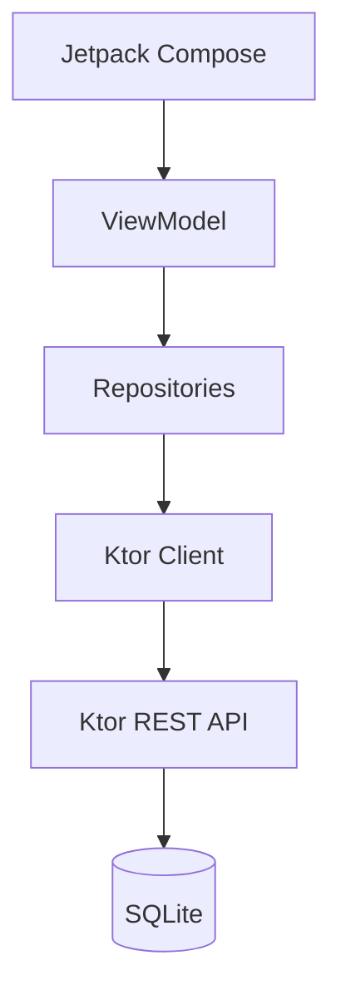
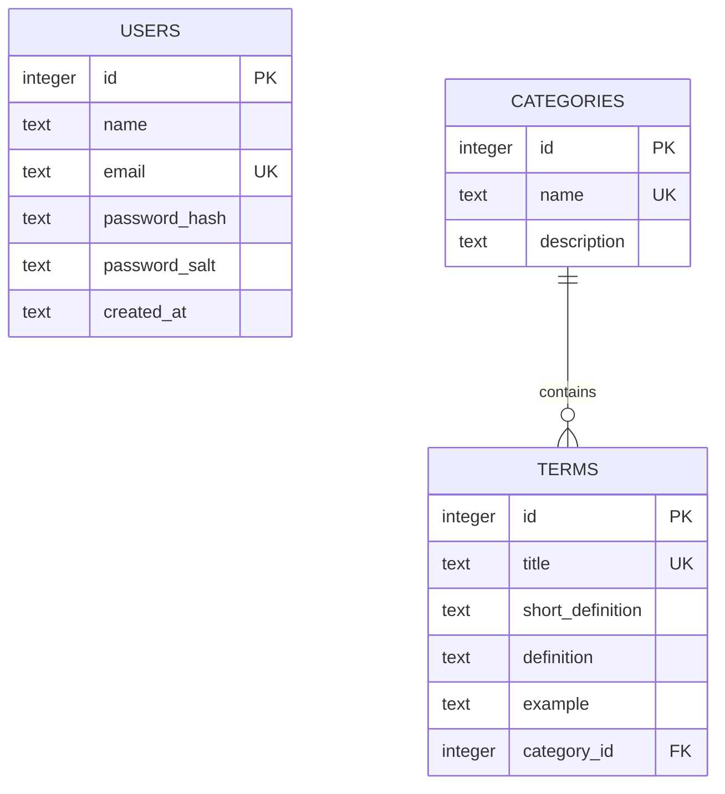

# Архитектура приложения

Клиент использует однонаправленный поток данных: экран отправляет событие во ViewModel, ViewModel вызывает репозиторий и публикует неизменяемое состояние, а Compose перестраивает затронутую часть интерфейса. `SavedStateHandle` хранит текст запроса; DataStore хранит токен, тему и десять последних открытых терминов.

Сервер разделён на маршруты, репозитории и слой доступа к данным. Пароли хешируются PBKDF2-HMAC-SHA256 с индивидуальной случайной солью. После входа клиент получает подписанный JWT сроком на сутки и передаёт его в заголовке `Authorization`.

## Схема данных

